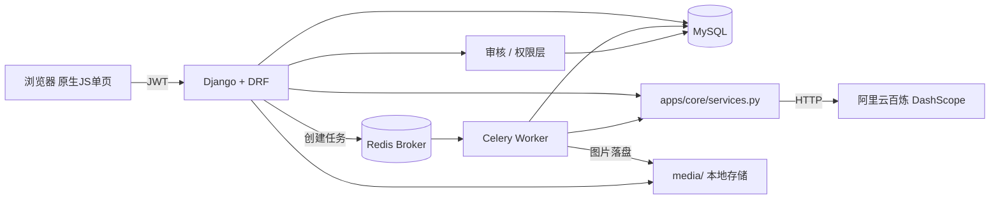
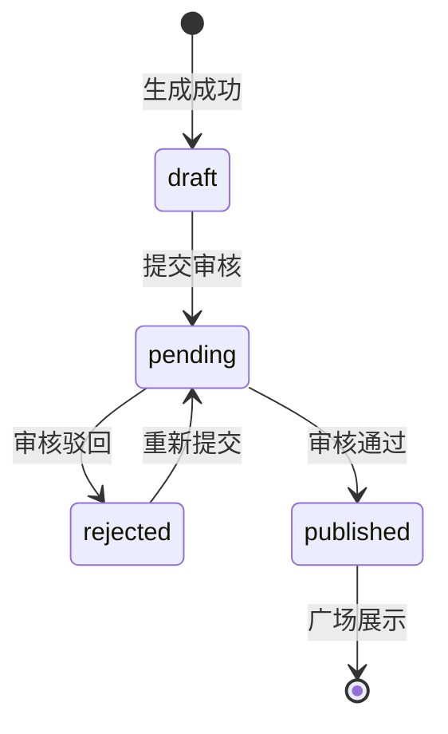

# Content Hub · AI 内容生成管理平台

一个从「AI 生成工具」扩展而来的内容管理系统：用户用一句话生成图片，作品经审核后进入广场，支持评论、搜索、个人中心，管理员可在后台管理作品、用户和评论。

> 项目定位：全栈 / Python AI 应用方向初级作品。

---

## 1. 解决的问题

- 单一文生图页面没有用户体系、没有内容生命周期，不算「系统」。
- 生成任务耗时，同步请求会卡住页面，需要异步化 + 前端轮询。
- AI 生成内容需要审核才能公开，涉及状态流转和角色权限。
- 管理员与普通用户看到的数据范围不同，需要接口层做数据隔离。

## 2. 技术栈

| 层 | 技术 |
| --- | --- |
| 后端 | Django 5 + Django REST Framework + SimpleJWT |
| 数据库 | MySQL 8（PyMySQL 驱动） |
| 异步 | Celery 5 + Redis（Windows 用 `--pool=solo`） |
| AI | 阿里云百炼 DashScope：文本走 OpenAI 兼容接口，文生图走原生异步接口 |
| 存储 | 本地 `media/` 文件系统，通过 `apps/common/storage.py` 抽象，可替换 MinIO/OSS |
| 前端 | 原生 HTML / CSS / JavaScript 单页，JWT 存 localStorage |
| 环境 | Python 3.13 + venv，配置项由 `django-environ` 从 `.env` 读取 |

## 3. 核心功能

- **用户**：独立登录 / 注册页面，账号密码正则校验，JWT 鉴权，401 自动跳登录页。
- **创作**：输入 prompt → 建任务 → Celery 异步生成 → 前端每 2 秒轮询状态 → 展示图片；支持「中止生成」。
- **审核闭环**：草稿/驳回 → 提交审核 → 待审 → 审核员通过/驳回 → 发布进广场；驳回可填原因，重新提交保留历史。
- **广场**：已发布作品列表、标题搜索、详情弹窗、登录后发表评论。
- **角色视图**：
  - 普通用户：创作台 / 广场 / 我的任务 / 个人中心。
  - 审核员：额外有「审核中心」，只能审核（通过/驳回），进不了管理后台。
  - 管理员：额外有「管理后台」（内容改删、评论管理）；**不能改用户角色**。
  - 超级用户（is_superuser）：在管理后台额外有「用户管理」，可增减管理员/审核员。相当于创世者
- **数据隔离**：任何账号（含管理员）的「我的任务 / 我的作品」只返回本人数据；全站数据只在审核中心 / 管理后台按权限开放。

## 4. 架构图



## 5. 内容状态机



生成任务状态：`pending → running → success / failed`；用户中止时写 `cancelled` 标记并撤销 Celery 任务，任务不再落库。

## 6. 目录结构

```text
content-hub/
├─ manage.py
├─ requirements.txt
├─ .env / .env.example            # 密钥等敏感配置，.env 不入库
├─ config/
│  ├─ settings/{base,dev,prod,test}.py
│  ├─ urls.py                     # 页面路由 + /api/health + 各 app include
│  └─ celery.py
├─ apps/
│  ├─ users/                      # 自定义 User、注册/登录/me
│  ├─ common/
│  │  ├─ responses.py             # 统一 {code,message,data}
│  │  ├─ storage.py               # 文件存储抽象
│  │  └─ ai_client.py
│  └─ core/                       # 业务主体
│     ├─ models.py                # 7 张业务表
│     ├─ serializers.py / views.py / urls.py
│     ├─ permissions.py           # IsReviewer / IsAdmin / IsSuperUser
│     ├─ services.py              # 文本/图片生成与下载
│     └─ tasks.py                 # Celery 生成任务（含取消检查）
├─ templates/
│  ├─ index.html                  # 单页：创作台/广场/任务/审核/后台/个人中心
│  ├─ login.html
│  └─ register.html
├─ tests/                         # 35 项 pytest 单元测试 + 2 个手动冒烟脚本
├─ bench/                         # 20 条评测集与一键评测脚本
│  ├─ prompts.json
│  ├─ run_benchmark.py
│  └─ results/latest.json
├─ docs/
│  ├─ 管理员任务视图改动与测试记录.md
│  └─ 优化故事_任务中止.md         # 面试核心故事
├─ Dockerfile / docker-compose.prod.yml / .dockerignore
├─ pytest.ini / requirements-{dev,prod}.txt
└─ media/                         # 生成的图片（不入库）
```

## 7. 本地启动

前置：MySQL 8 已建库 `content_hub`（utf8mb4）、Redis 已运行。

```cmd
cd /d C:\Users\JAYSTP\projects\content-hub
venv\Scripts\activate
python -m pip install -r requirements.txt
python manage.py check
python manage.py migrate
python manage.py runserver
```

另开一个终端跑异步任务：

```cmd
cd /d C:\Users\JAYSTP\projects\content-hub
venv\Scripts\activate
celery -A config worker -l info --pool=solo
```

浏览器访问 `http://127.0.0.1:8000/`。改过 `.py` 后需重启 `runserver`；改过 `tasks.py` 还需重启 worker。Windows 必须用 `--pool=solo`，否则 prefork 无法启动。

## 8. 环境变量

复制 `.env.example` 为 `.env` 后填写，`.env` 已被 `.gitignore` 忽略。

| 变量 | 说明 |
| --- | --- |
| `DB_NAME` / `DB_USER` / `DB_PASSWORD` / `DB_HOST` / `DB_PORT` | MySQL 连接 |
| `REDIS_HOST` / `REDIS_PORT` | Redis 连接 |
| `CELERY_BROKER_URL` / `CELERY_RESULT_BACKEND` | Celery Broker / Backend |
| `DASHSCOPE_API_KEY` / `DASHSCOPE_BASE_URL` | 百炼 Key 与专属 Base URL，必须配套 |
| `USE_MOCK_AI` | `true` 时用假数据跑通流程，不调用真实 API |
| `SECRET_KEY` / `DEBUG` / `ALLOWED_HOSTS` | Django 基础配置 |

> 专属 Base URL 只支持模型列表内的模型，文生图走 DashScope 原生异步接口，尺寸参数用 `1024*1024` 而不是 `1024x1024`。

## 9. 主要接口

统一响应：`{ "code": 0, "message": "ok", "data": ... }`，鉴权头 `Authorization: Bearer <access>`。

| 方法 | 路径 | 说明 |
| --- | --- | --- |
| POST | `/api/users/register/` / `login/` | 注册 / 登录 |
| GET | `/api/users/me/` | 当前用户 |
| POST | `/api/generation/tasks/` | 创建生成任务（异步） |
| GET | `/api/generation/tasks/` | 我的任务 |
| POST | `/api/generation/tasks/{id}/cancel/` | 中止任务 |
| GET | `/api/content/` / `search/?q=` | 广场 / 标题搜索 |
| GET | `/api/content/mine/` | 我的作品（含审核状态） |
| POST | `/api/content/{id}/submit-review/` | 提交审核 |
| GET/POST | `/api/comments/` | 评论列表 / 发表 |
| GET | `/api/review/tasks/` `?status=all` | 待审 / 全站审核记录 |
| POST | `/api/review/tasks/{id}/approve|reject/` | 通过 / 驳回 |
| GET/PATCH | `/api/admin/content/` `/api/admin/comments/` | 管理后台（管理员）：改作品 / 删评论 |
| GET/PATCH | `/api/admin/users/` `/api/admin/users/{id}/role/` | 用户管理（仅超级用户）：增减管理员/审核员 |

## 10. 数据模型

`User`（扩展 role/nickname/level/points）、`GenerationModel`、`ReferenceImage`、`GenerationTask`、`Content`、`ReviewTask`、`Comment`。

关键关系：`GenerationTask → Content → ReviewTask → Comment`；`Content.status` 与 `ReviewTask.status` 共同驱动状态机。

## 11. 单元测试（pytest）

测试使用 `config.settings.test`：**内存 SQLite + 强制 Mock AI**，不连 MySQL/Redis、不调用百炼、零费用，任何人 clone 后可直接跑。

```cmd
venv\Scripts\activate
python -m pip install -r requirements-dev.txt
python -m pytest              # 35 passed
python manage.py check
```

覆盖范围：

| 文件 | 覆盖内容 |
| --- | --- |
| `test_auth.py` | 注册正则（5 组非法输入）、重复用户名、登录支持用户名/邮箱、me 字段 |
| `test_tasks.py` | 任务归属隔离、越权 404、中止标记与 revoke、**优化前后对照**、Mock 全闭环、视频占位 |
| `test_review.py` | 提交审核 → 通过/驳回、驳回后重提保留历史、重复提交拦截、`?status=all` 共享、角色越权 |
| `test_content.py` | 广场只显已发布、搜索、评论、我的作品隔离与审核状态 |
| `test_services.py` | 尺寸规范化、Mock 零网络、缺 Key/HTTP 错误/无结果的异常流程 |

另有 2 个**手动冒烟脚本**（`tests/manual_ai_smoke.py`、`tests/manual_task_flow.py`，前缀 `manual_` 不会被 pytest 收集），会真实调用百炼并产生费用，按需运行。

> 优化故事的可量化对照见 `docs/优化故事_任务中止.md`。

## 12. 量化评测

```cmd
python bench\run_benchmark.py           # Mock 模式，零费用
python bench\run_benchmark.py --live    # 真实调用百炼，20 张图会产生费用
```

- 评测集：`bench/prompts.json` 共 20 条，覆盖动物/人物/物品/场景/风格/构图/中文文化/异常 robustness。
- 自动指标：成功率（预期失败用例单列）、平均耗时、P95、行为正确率。
- 语义准确率需人工对照每条 `expect` 字段核对（`results/latest.json` 中 `semantic_ok` 列）。
- 结果落在 `bench/results/latest.json` 与 `history/`，便于对比优化前后。

当前 Mock 基线（2026-11-24）：19 个正常用例成功率 100%，1 个异常用例行为正确，行为正确率 100%，平均耗时 0.02s，P95 0.13s。**这是流程基线，不是模型质量分数**——真实质量需 `--live` 后人工核对。

## 13. 生产部署

```cmd
docker compose -f docker-compose.prod.yml up -d --build
```

- `web`：gunicorn（2 workers × 4 threads）+ whitenoise 提供静态文件，启动时自动 `migrate`。
- `celery`：worker 用 `--pool=solo`，与本地一致，配合数据库取消标记。
- `db` / `redis`：MySQL 8 与 Redis 7，带健康检查和数据卷。
- 密钥全部从 `.env` 读取；compose 显式覆盖 `DEBUG=False`，避免开发配置进生产。
- 部署前需在 `.env` 设置生产 `SECRET_KEY`、`ALLOWED_HOSTS`（域名/IP）、`CSRF_TRUSTED_ORIGINS`。

> 当前文件已通过 `docker compose config` 静态校验；本机 Docker 守护进程未启动，尚未实际构建运行。

## 14. 功能截图

截图素材放在 `.screenshots/`（当前为空，待采集）。采集方式：启动服务后用浏览器访问 `http://127.0.0.1:8000/`，依次截取——

1. 创作台：输入 prompt、生成结果卡片与「提交审核」按钮；
2. 作品广场：搜索框、作品卡片、详情弹窗与评论；
3. 审核中心（管理员）：待审列表与通过/驳回；
4. 管理后台（超级用户）：内容/用户/评论三分区；
5. 个人中心：五项统计与作品审核状态。

## 15. 已知局限与改进方向

- 视频生成尚未接入，前端选项为占位；提示词中的动态描述目前无效。
- 创作页「画面风格」输入框未拼进 prompt，所有描述需写在「画面描述」框。
- 文件存本地 `media/`，未启用 MinIO/OSS；生产 compose 已用卷持久化，但多副本 web 需共享存储或改 OSS。
- 前端为原生 JS 单页，未引入 Vue Router；页面切换靠 `data-page` 而非真实路由。
- 评测当前为 Mock 基线，模型语义质量待 `--live` 评测 + 人工核对补齐。
